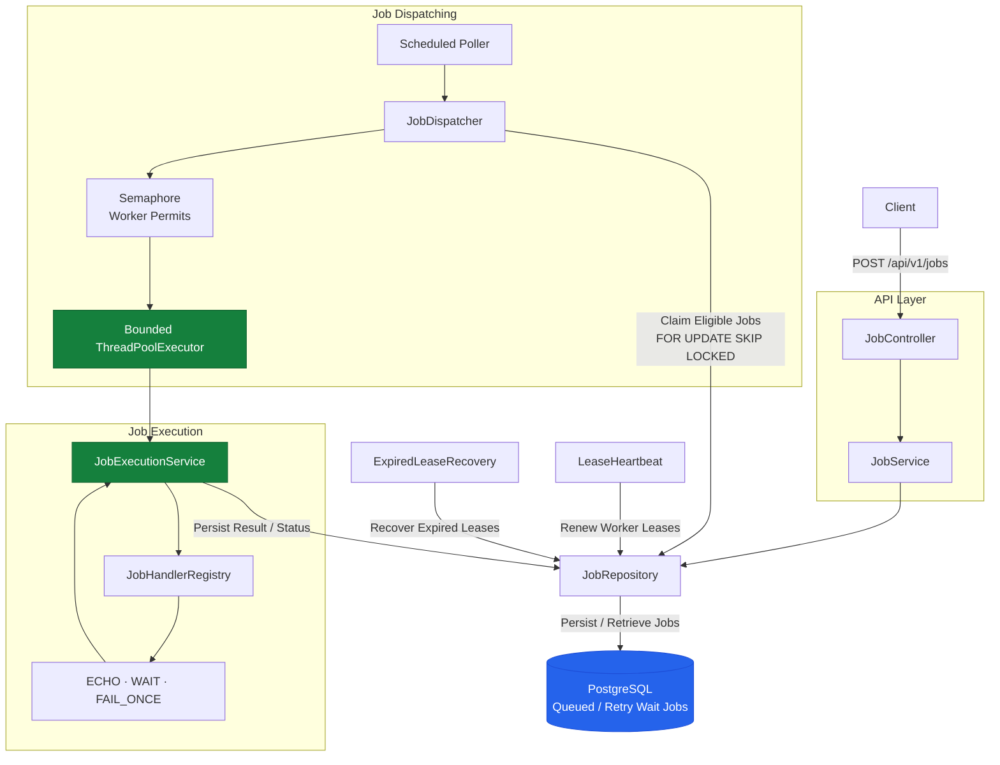

# Java Batch Job Orchestrator

A database-backed job execution service demonstrating: bounded concurrency, atomic work claiming, explicit state transitions, delayed execution, retries, idempotent submissions, and worker-crash recovery.

> **Scope:** This is a portfolio-grade reference implementation, not a drop-in replacement for a mature queue such as Amazon SQS, RabbitMQ, or Kafka.

## Technology

- Java 21
- Spring Boot 4.1.2 (Spring MVC, validation, scheduling, Actuator)
- PostgreSQL 17 with JSONB
- Spring JDBC and Flyway migrations
- Micrometer metrics
- JUnit 5 and Testcontainers for container-backed PostgreSQL integration tests
- Maven

## Features

1. **Bounded worker concurrency.** A fixed-size `ThreadPoolExecutor` uses a `SynchronousQueue`; a fair semaphore prevents the dispatcher from claiming more work than the worker pool can accept.
2. **Atomic multi-worker claiming.** A PostgreSQL `UPDATE ... FROM (SELECT ... FOR UPDATE SKIP LOCKED)` claim operation lets multiple application instances claim different rows without waiting on already-locked candidates.
3. **Explicit lifecycle.** Jobs move through `QUEUED → RUNNING → SUCCEEDED | RETRY_WAIT | FAILED`, with cancellation allowed only before execution. Retry-waiting jobs become eligible again when their scheduled `run_at` time arrives.
4. **Retry and backoff.** Transient failures are retried with capped exponential backoff. Unknown handler types and permanent handler errors are treated as permanent failures.
5. **Idempotent submission.** `Idempotency-Key` is protected by a unique database index. Replaying the same request returns the original job; reusing a key with a different request fingerprint returns `409 Conflict`.
6. **Lease and heartbeat recovery.** Workers periodically extend a lease. A separate recovery task moves jobs with expired leases into retry or failed state after a worker crash.
7. **Extensible handlers.** A new job type is implemented as a Spring `@Component` implementing `JobHandler`; arbitrary code is never accepted through the API.
8. **Observability.** Key-value lifecycle logs and Micrometer counters are exposed through Spring Boot Actuator.

## Architecture


### Job lifecycle


An expired `RUNNING` lease is reconciled by the recovery scheduler. Depending on the remaining attempt budget, the job moves to `RETRY_WAIT` or `FAILED`. Terminal states (`SUCCEEDED`, `FAILED`, `CANCELLED`) cannot transition again. Worker-owned SQL updates check the expected current status and worker ID so stale workers cannot overwrite a newer worker's state.

## Requirements

- JDK 21
- Maven 3.9+ recommended
- PostgreSQL 17

Docker is optional for local development. The application can run directly on Windows against a native PostgreSQL installation. Docker is only needed for the optional Compose database setup and for Testcontainers integration tests.

Check the installed tools in PowerShell:

```powershell
java -version
mvn -version
psql --version
```

## Run locally with native PostgreSQL

The native PostgreSQL setup is the recommended development path and does not require Docker.

### 1. Create the role and databases

In pgAdmin's Query Tool, connected as a PostgreSQL administrator, run:

```sql
CREATE ROLE orchestrator
WITH LOGIN PASSWORD 'change_this_password';

CREATE DATABASE orchestrator
OWNER orchestrator;

CREATE DATABASE orchestrator_test
OWNER orchestrator;
```

Use the dedicated `orchestrator_test` database for native integration tests. Those tests clear the `jobs` table between test cases. Never point them at the development database or a database containing data that needs to be retained.

### 2. Configure local credentials

Copy `src/main/resources/application-local.example.yml` to `src/main/resources/application-local.yml` and set the local PostgreSQL password. The local file is Git-ignored and should not be committed.

The local profile connects to the native PostgreSQL server on port `5432`:

```yaml
spring:
  datasource:
    url: jdbc:postgresql://localhost:5432/orchestrator
    username: orchestrator
    password: change_this_password
```

The committed `application.yml` selects the `local` profile by default. Flyway applies database migrations automatically at application startup.

### 3. Build and run

```powershell
mvn clean verify
mvn spring-boot:run
```

The API starts on port `8080` by default.

- API base: `http://localhost:8080/api/v1`
- Health: `http://localhost:8080/actuator/health`
- Metrics: `http://localhost:8080/actuator/metrics`
- Supported job types: `http://localhost:8080/api/v1/job-types`

## Optional native PostgreSQL integration tests

Create `src/test/resources/application-native-test.yml` with the connection details for the dedicated test database:

```yaml
spring:
  datasource:
    url: jdbc:postgresql://localhost:5432/orchestrator_test
    username: orchestrator
    password: change_this_password
  flyway:
    enabled: true
```

Keep this credentials file Git-ignored. Run the native PostgreSQL integration tests with:

```powershell
mvn -DnativePostgres=true verify
```

The native tests exercise database-backed idempotency and concurrent job claiming. They are intended to run only against the dedicated disposable test database.

## Optional Docker setup

Docker is not required to run the Java application when using native PostgreSQL. To use the Compose-managed database instead, start only the database service:

```powershell
docker compose up -d db
```

The Compose database is exposed on host port `5433` (container port `5432`) to avoid conflicting with a native PostgreSQL server on port `5432`. When the Java application runs directly on Windows, configure its JDBC URL as `jdbc:postgresql://localhost:5433/orchestrator`.

Stop the database with:

```powershell
docker compose down
```

To also remove persisted development data:

```powershell
docker compose down -v
```

Testcontainers-based PostgreSQL tests require Docker and are automatically skipped when Docker is unavailable. The native PostgreSQL integration-test path is available for development environments without Docker.

## Configuration

The application supports Spring configuration profiles and environment-variable overrides. Keep machine-specific credentials in ignored local configuration files or environment variables; do not commit passwords.

| Setting | Default / example | Meaning |
|---|---|---|
| `SPRING_DATASOURCE_URL` | `jdbc:postgresql://localhost:5432/orchestrator` for native PostgreSQL | PostgreSQL JDBC URL |
| `SPRING_DATASOURCE_USERNAME` | `orchestrator` | Database user |
| `SPRING_DATASOURCE_PASSWORD` | Set locally | Database password |
| `WORKER_THREADS` | `4` | Maximum concurrent handlers per application instance |
| `DISPATCH_INTERVAL_MS` | `500` | How often queued jobs are polled |
| `LEASE_DURATION_SECONDS` | `60` | How long a worker claim remains valid without heartbeat |
| `HEARTBEAT_INTERVAL_MS` | `10000` | Active lease renewal interval; keep comfortably below the lease duration |
| `RECOVERY_INTERVAL_MS` | `5000` | Expired-lease scan frequency |
| `BASE_RETRY_DELAY_SECONDS` | `2` | Base retry delay |
| `MAX_RETRY_DELAY_SECONDS` | `60` | Exponential backoff cap |

The semaphore and executor use the same `WORKER_THREADS` setting. If the lease duration changes, keep the heartbeat interval comfortably below it; the defaults renew every 10 seconds for a 60-second lease.

## API examples

### 1. Submit an echo job

```powershell
$body = @{
  type = "ECHO"
  payload = @{ message = "Hello from Java" }
  maxAttempts = 3
  priority = 2
} | ConvertTo-Json -Depth 5

Invoke-RestMethod -Method Post `
  -Uri http://localhost:8080/api/v1/jobs `
  -ContentType "application/json" `
  -Headers @{ "Idempotency-Key" = "demo-echo-001" } `
  -Body $body
```

A successful new submission returns `201 Created` and a job ID. Repeating the same request with the same idempotency key returns the original job with `200 OK`. Reusing the key with a different request fingerprint returns `409 Conflict`.

### 2. Simulate a transient failure and retry

```powershell
$body = @{
  type = "FAIL_ONCE"
  payload = @{ message = "Recovered successfully" }
  maxAttempts = 3
} | ConvertTo-Json -Depth 5

$job = Invoke-RestMethod -Method Post `
  -Uri http://localhost:8080/api/v1/jobs `
  -ContentType "application/json" `
  -Body $body

$job.id
```

`FAIL_ONCE` deliberately throws on attempt 1 and succeeds on attempt 2. Poll the job using `GET /api/v1/jobs/{id}`. The first failure should produce `RETRY_WAIT`; after the backoff delay, the job should return to `RUNNING` and eventually become `SUCCEEDED`.

### 3. Demonstrate concurrent workers

```powershell
$body = @{
  type = "WAIT"
  payload = @{ durationMs = 5000 }
  maxAttempts = 1
} | ConvertTo-Json -Depth 5

# With WORKER_THREADS=4, at most four handlers execute concurrently per instance.
1..8 | ForEach-Object {
  Invoke-RestMethod -Method Post `
    -Uri http://localhost:8080/api/v1/jobs `
    -ContentType "application/json" `
    -Body $body
}
```

### 4. List and inspect jobs

```powershell
Invoke-RestMethod "http://localhost:8080/api/v1/jobs?limit=20"
Invoke-RestMethod "http://localhost:8080/api/v1/jobs?status=SUCCEEDED&limit=20"
Invoke-RestMethod "http://localhost:8080/api/v1/jobs/<JOB_ID>"
```

### 5. Cancel a pending job

```powershell
Invoke-RestMethod -Method Delete `
  -Uri "http://localhost:8080/api/v1/jobs/<JOB_ID>"
```

Only `QUEUED` and `RETRY_WAIT` jobs can be cancelled. Running cancellation is intentionally not implemented because safe cancellation requires cooperative interruption and handler-specific cleanup semantics.

## Adding a job handler

Create a Spring component implementing `JobHandler`:

```java
@Component
public class ReportJobHandler implements JobHandler {
    @Override
    public String type() {
        return "REPORT";
    }

    @Override
    public JsonNode execute(JsonNode payload, JobExecutionContext context) {
        // Validate the payload and perform bounded work.
        // Return a JSON result using the application's JSON mapper.
        // Use context.jobId() as a stable idempotency key for external side effects.
        ObjectNode result = JsonNodeFactory.instance.objectNode();
        result.put("jobId", context.jobId().toString());
        result.put("status", "processed");
        return result;
    }
}
```

The type is automatically added to `GET /api/v1/job-types`. Keep handlers idempotent: a process can crash after an external side effect but before recording `SUCCEEDED`, so the lease recovery path may execute the same logical job again.

## Observability

The application exposes Spring Boot Actuator health and metrics endpoints. Micrometer counters currently cover:

- `orchestrator.jobs.submitted`
- `orchestrator.jobs.idempotent_replays`
- `orchestrator.jobs.cancelled`
- `orchestrator.jobs.succeeded`
- `orchestrator.jobs.retried`
- `orchestrator.jobs.failed`

For example:

```text
http://localhost:8080/actuator/metrics/orchestrator.jobs.succeeded
http://localhost:8080/actuator/metrics/orchestrator.jobs.retried
```

Lifecycle logs include job ID, handler type, attempt number, retry delay, and failure details where applicable. Metrics are maintained per application instance; the project does not currently provide a centralized metrics backend or dashboard.

## Reliability semantics and limitations

- **At-least-once execution, not exactly-once.** A lease timeout means the previous worker's outcome is unknown. The handler may be retried, so external side effects must be idempotent or protected by their own idempotency key or transaction.
- **Submission idempotency is not execution idempotency.** The `Idempotency-Key` prevents duplicate job rows for the same request fingerprint and rejects key reuse with a different request. It does not make handler side effects exactly-once. The JSON payload is fingerprinted in its serialized property order, so send consistent JSON property ordering when replaying a request.
- **No distributed lock service is required.** PostgreSQL row locks and `SKIP LOCKED` coordinate multiple application instances sharing the same database.
- **Running jobs cannot be cancelled yet.** Pending jobs can be cancelled atomically.
- **Authentication is intentionally omitted.** Do not expose this service publicly without authentication, authorization, TLS, rate limits, and secret management.
- **Handler work is bounded by design.** The sample `WAIT` handler caps duration at 30 seconds. Production handlers should have explicit timeouts and bounded resource usage.
- **Benchmark results are environment-specific.** They are observations from the development machine and are not a production capacity guarantee.

## Tests

The project supports unit tests, native PostgreSQL integration tests, and Testcontainers-based integration tests.

### Unit tests

```powershell
mvn test
```

Unit tests cover job lifecycle transitions, exponential retry backoff, and handler registration.

### Native PostgreSQL integration tests (no Docker)

Configure `src/test/resources/application-native-test.yml` to connect to the dedicated `orchestrator_test` database, then run:

```powershell
mvn -DnativePostgres=true verify
```

These tests cover database-backed idempotency and concurrent job claiming. They clear test rows between cases, so use only a dedicated disposable test database.

### Testcontainers integration tests

The Testcontainers tests exercise PostgreSQL repository behaviour using a disposable PostgreSQL container. They require Docker and are automatically skipped when Docker is unavailable.

## Performance and reliability validation

The following results were observed during local manual validation. They are project measurements, not universal performance claims.

### 40-job load test

Configuration:

- 2 independent Spring Boot instances
- 2 worker threads per instance (4 total)
- 40 `WAIT` jobs with a 1-second handler duration
- 8 concurrent HTTP submission clients
- Shared PostgreSQL database

Results:

| Metric | Observed result |
|---|---:|
| Jobs submitted | 40 |
| Jobs succeeded | 40 |
| Jobs failed | 0 |
| Peak observed running jobs | 4 |
| Total elapsed time | 14.59 seconds |
| Throughput | 2.74 jobs/second |
| Submission latency (p50) | 16.26 ms |
| Submission latency (p95) | 1266.25 ms |
| Observed completion latency (p50) | 8156.39 ms |
| Observed completion latency (p95) | 12794.92 ms |

Completion latency includes queue waiting and the benchmark script's polling interval. The peak running count was sampled during the test.

### Concurrent idempotency test

Twenty simultaneous identical HTTP submissions were sent across two application instances:

- 1 job creation response (`201 Created`)
- 19 idempotent replay responses (`200 OK`)
- 1 unique job ID across all responses
- 0 request errors

Reusing the same idempotency key with a different payload was also manually verified to return `409 Conflict`.

### Worker-crash recovery test

A running `WAIT` job was interrupted by forcefully terminating its application process. The recovery scheduler logged one expired lease, moved the abandoned job back into the retry lifecycle, and a worker completed it successfully on attempt 2.

### Multi-instance validation

Two Spring Boot instances were run against the same PostgreSQL database. Both participated in job execution, and the 40-job benchmark completed successfully with four total worker threads. The concurrent idempotency test also exercised simultaneous submissions through both instances.
